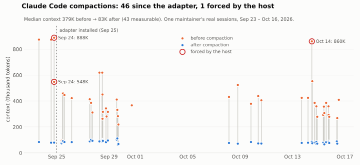

# Context Handoff

Context Handoff keeps a coding agent on the same task across context compaction. It saves a handoff before compaction, hands it back afterward with a note that the last message was already handled, and indexes the original messages so the agent can look up whatever the summary dropped.

Built for Claude Code (in daily use) and Codex (hooks, plus an optional patched build as a source preview).

Using Codex? The hooks need no build and install in a couple of minutes: [Codex hooks install](#codex-hooks).

## What it fixes

| Problem | What we do | Status |
|---|---|---|
| Cut off mid-task; reasons and rejected approaches get lost | The agent compacts at a natural break, after writing a handoff; a snapshot of the handoff is kept | Claude Code: yes. Codex hooks: reminders only; the host decides when to compact |
| The summary drops a detail | After compaction, sentences the summary missed are put back automatically, with their time and who said them. Original words and tool results can also be fetched by ID, hash-checked | Claude Code: yes. Codex hooks: fetch by ID |
| Rules stop being followed, or nobody knows who said them | The source is one lookup away. A per-rule record of who said it, when, and whether it still holds | Lookup: yes. Per-rule record: planned |
| Finished work gets redone | After compaction the agent is told the last request was already handled; the Codex patches drop it from replay | Reminder: yes. Host-level: Codex patches (preview) |
| An old handoff overrides a newer message | Freshness check before compaction | Yes. Showing messages sent after the snapshot: planned |
| The agent stops after compaction | The agent chooses `continue` or `wait` when it schedules compaction; with `continue` the plugin sends one labelled prompt afterwards to resume authorised work | Claude Code: yes. Codex: patches (preview) |
| Compaction is slow or gets stuck | Large tool output is kept in files, so there is less to compact | Partial |

What each part has been tested on: [Details](#details) and [the verification record](docs/VERIFICATION.md).

## Results

One maintainer's daily use of the Claude Code adapter, 2026-09-25 to 2026-10-16:

- **46 compactions: 45 at a break the agent or user chose, 1 forced by the host.**
- **Median context 379K → 83K tokens** (43 measurable). About 70K of what remains is fixed overhead.
- Handoff snapshots kept at real compactions: 45 snapshots at 24 compactions in 7 sessions (2026-10-16 to 10-21).
- The one forced compaction (860K) came during a 49-tool-call turn with no user message, when reminders only ran on user turns. Reminders now also run after tool calls.



How these were measured, and more: [the verification record](docs/VERIFICATION.md).

## Install

For an AI following this README: choose **one** host path, inspect its preview before applying it, and check the doctor's actual output. Run commands from the checkout root. Keep the checkout at that path: installed hooks point to it.

### Get the checkout

1. Clone the repository and enter it:

   ```sh
   git clone https://github.com/Ubadream/context-handoff
   cd context-handoff
   ```

   Success: the checkout contains `README.md`, `adapters/claude/cw_install.py` and `adapters/codex/install_codex_hooks.py`. If cloning fails, inspect Git's network/access error; if the target already exists, inspect that checkout rather than overwriting it.

2. Check the common prerequisites:

   ```sh
   git --version
   python --version
   ```

   Success: Git prints its version and Python is **3.11+**. If either command is missing, install it or select the correct executable, then repeat. The Python core uses only the standard library.

### Claude Code

Requires Claude Code with **function hooks** (an early-access feature) and `node` and `claude` available on PATH. Messages default to Traditional Chinese.

1. Preview:

   ```sh
   python adapters/claude/cw_install.py apply --dry-run
   ```

   Success: prints the proposed `settings.json`, legacy-hook and marketplace changes (`要改` / `change`; `不用改` / `no change`), without applying them. If parsing fails, inspect the named `~/.claude/settings.json`; a missing script means you are outside the checkout root.

2. Apply the reviewed changes:

   ```sh
   python adapters/claude/cw_install.py apply
   ```

   Success: ends with `完成；重開 Claude 才生效，重開後跑 doctor 再看一次` (complete; restart Claude, then run doctor). It backs up an existing changed settings file as `settings.json.bak-cw-<timestamp>`, rewires matching hooks while retaining others, sets `CLAUDE_CODE_ENABLE_FUNCTION_HOOKS=1`, `CW_WORKBENCH` and `CW_PYTHON`, and installs `wife-compact` through this checkout's local marketplace. Existing same-name legacy hook files are backed up and replaced with forwarding shims. If a plugin command fails, inspect its stderr and the marketplace path; if readback differs, stop and inspect the adjacent settings backup before restarting.

3. Restart Claude Code, then finish with doctor:

   ```sh
   python adapters/claude/cw_install.py doctor
   ```

   Success: hooks, environment and plugin rows say `ok`, `node` and `claude` are found, and the final line is `全部接好` / `all connected`. Missing legacy shims (`沒檔` / `missing file`) are acceptable on a fresh installation. For `沒接` / `not connected`, `別處` / `elsewhere`, `舊版` / `old version` or `沒開` / `off`, inspect the reported path/version and repeat the preview/apply cycle after correcting it. Also read the dependency rows, since the final line does not cover every dependency.

4. English messages: `python adapters/claude/cw_thresholds.py set --language en`. Use `--language zh` to switch back. `CW_LANG=en|zh` overrides the setting; installation also accepts `cw_install.py apply --language en`.

### Codex hooks

Requires Codex with hooks; **0.159.2** is the verified version. Start here for an existing Codex installation without a rebuild.

1. Preview:

   ```sh
   python adapters/codex/install_codex_hooks.py apply --dry-run
   ```

   Success: prints proposed config text or `would change ...`, without writing. Inspect errors about a damaged marked block or invalid config before proceeding.

2. Apply:

   ```sh
   python adapters/codex/install_codex_hooks.py apply
   ```

   Success: prints `wrote:` and a trust/restart instruction. It backs up existing `$CODEX_HOME/config.toml`, adds one marked block and enables `[features] hooks = true`, preserving other hooks. If it fails, inspect the reported config and backup; do not replace the whole config to bypass the error.

3. Review and trust these four commands through Codex, or use the installer:

   ```sh
   python adapters/codex/install_codex_hooks.py trust
   ```

   Success: writes the trust entries after querying Codex's own `hooks/list` hashes. If Codex cannot be found, select its executable with the supported `--codex` option; if fewer than four hooks are listed, check the config and hooks feature first. This command trusts only this adapter's four commands.

4. Restart Codex, then finish with doctor:

   ```sh
   python adapters/codex/install_codex_hooks.py doctor
   ```

   Success: `block: present`, `features: hooks = True`, script `ok`, and **four** enabled hooks with `trust=trusted`. If it prints `could not ask Codex`, check the Codex executable using `--codex`; for missing/untrusted rows, return to apply/trust and check again.

### Codex patches (source preview)

Use this path only if you want to build the source preview. Requires Linux or Windows, Git, Python 3.11+, [Rust](https://rustup.rs), and Visual Studio C++ build tools on Windows. The first build takes a long time and **tens of GB**. It is pinned to **Codex 0.159.2, commit `ff6aec9`**.

1. Plan:

   ```sh
   python adapters/codex/install_codex.py plan
   ```

   Success: prints the pinned upstream, verified patch hashes, reviewed tree, source/install paths and no `missing:` tools. If a tool is missing or hash verification fails, resolve that issue before building. `plan` only checks tools on PATH; the C++ toolchain is exercised by the build step.

2. Build and install the separate runtime:

   ```sh
   python adapters/codex/install_codex.py install
   ```

   Success: ends with `installed:` and `run it with:` naming the `codex-handoff` launcher. The installer verifies the patch-series hashes and patched tree, uses upstream's packaging script, and checks that `Cargo.lock` did not change. On failure, inspect the printed build command and error; do not bypass hash/tree checks. If a target already exists, inspect that installed copy before deciding whether to uninstall it. `--profile dev-small` is the supported faster, unoptimized alternative; the default profile is `release`.

3. Finish with doctor:

   ```sh
   python adapters/codex/install_codex.py doctor
   ```

   Success: prints the installed executable's version, `ok:` and `launcher:`, and exits 0. For `not installed:` or `problem:`, inspect the named install, marker, executable or launcher.

The runtime installs under `$CODEX_HOME/runtimes/` with its own launcher and leaves the existing Codex binary, config and desktop app untouched. The launcher enables checkpoint reminders for that invocation. It still reads the same `~/.codex`; upstream releases require a patch rebase. `uninstall` removes only the installer-marked runtime.

## Details

### Claude capture and retrieval flow

    user message ─► UserPromptSubmit: context_watch (threshold reminders)
    tool call ────► PreToolUse/PostToolUse: tool_archive (full copy + ID)
                                            tool_output_trim (large output → file)
                                            context_watch (reminders inside long tool loops too)
    agent ────────► wife-compact tools: prepare / segments / handoff_check / compact / get / context
    end of turn ──► wife-compact: run the compaction the agent scheduled
                    (drop confirmed segments → tool calls to one line → A or C)
    compaction ───► PreCompact: handoff_snapshot (full text + SHA-256 of the handoff at that moment)
    after compact ► SessionStart: handoff_bind (hand the agent back its own handoff file)

State lives under `~/.local/state/wifeos/` (override with `CW_STATE_ROOT`).

The two compaction modes: **A** uses the host's built-in summary; **C** is the summary plus the full pre-compaction text saved to a file, indexed by section with content hashes, so any part can be read back.

### Claude Code adapter (`adapters/claude/`)

| Feature | What it does | Measured on a real session |
|---|---|---|
| Agent-chosen compaction | A `compact` tool lets the agent schedule compaction at a natural break, after updating its handoff, in mode A or C. Compaction is blocked if no handoff was written since the last one, unless the agent gives a reason. | |
| Continue or wait | `compact` takes `next`: `continue` when authorised work is unfinished, `wait` when a user decision is pending. With `continue`, once compaction finishes the plugin submits one prompt, explicitly labelled as coming from the plugin and not the user: read the handoff, resume, don't redo finished work. At most once per compaction; if the user types first, the user's message wins. Plugin prompts are never recovered as the user's words. | Resumed without a user message after 3 real compactions (2026-10-20 to 10-21). In a calibration run of the controlled evaluation (Claude Haiku, toy project), the plugin arm resumed and finished the task, 8/8 tests; the arm without the plugin stopped after compaction. |
| Tool round-trips to one line | At compaction every tool call becomes one line with an ID; the full call and result are archived locally and `get <id>` brings them back. | 579 messages → 30, 498,605 → 38,102 characters (one compaction, 2026-09-30) |
| Segment and drop | The conversation is split at each user message. An optional model labels each segment and suggests which are finished; the agent confirms which to drop. The user's own words in dropped segments are kept; the rest is retrievable by segment ID. | 3 segments dropped: 602,545 → 498,605 characters (same compaction) |
| Large output kept out of context | A PostToolUse hook saves large Bash/PowerShell, Grep, WebFetch/WebSearch and browser page-text output to a file and keeps head + tail + path. Large `Read` results keep only the first lines with correct line numbers and say where to continue. | a 37,322-character Grep result → about 3,500 |
| Handoff check | Before compacting: is the handoff newer than the last user message and file edit? The optional model lists what the handoff may have missed. | |
| Thresholds and idle reminder | Reminders at configurable context sizes. If the user goes idle with a large context, one reminder before the prompt cache expires asks the agent to write its handoff and compact, so the user doesn't pay to re-read the whole window. | |
| Fixed-overhead diet | Rarely used tools are deferred and long skill descriptions shortened (switchable). | |
| Three-part handoffs (optional, off by default) | `python adapters/claude/cw_thresholds.py set --handoff-sections on`: reminders and the handoff check ask for a handoff in three parts, decisions / feelings / progress, each item with a pointer back to the original words (time and a short quote, or an originals ID), and the check warns, without blocking, when a part or any pointer is missing. | |

### Codex hooks (`adapters/codex/hooks/`)

**No rebuild.** Added 2026-10-11. Four standard Codex hooks, one Python script, nothing compiled. It uses standard hook events, so it does not depend on a pinned Codex build. Tested with Codex 0.159.2.

| Hook | What it does |
|---|---|
| PostToolUse, UserPromptSubmit | Context-size reminders, once per threshold until the next compaction. Default: at 60% of the model's context window, update the handoff at the next natural break; at 80%, save it now and tell the user it is a good point to run `/compact`. |
| PreCompact | Records where the transcript ended, which handoff file is newest in the working directory, and when the user last spoke. Keeps a copy of that handoff as it is at this moment (`context-handoff/handoff-snapshots/`, stored once per SHA-256, one index line per compaction), since handoff files are overwritten in place. |
| SessionStart (compact) | Tells the agent which handoff to read first, and whether it was saved before or after the user's latest message; says the last request in the summary is not a new one; names the saved copy; points to an index of the part that was just compacted. |
| (command) | `list <ID>` and `get <ID>§N` read a section of the compacted transcript back, split at each user message, after checking its SHA-256 against the index. |

**What hooks cannot do, compared with the patches:**

| | Hooks | Patches |
|---|---|---|
| Who starts compaction | The user (`/compact`) or the host's automatic limit; the agent can only ask | The agent, with a `handoff_compact` tool, at a break it picks |
| Not replaying the last request | An instruction after compaction | The handoff is bound to the request it covers; the host does not replay it |
| Handoff | Newest `HANDOFF*.md` in the working directory, with a freshness check | A copy stored and bound to the thread at prepare time |
| Codex upgrades | Uses standard hooks; recheck compatibility | Pinned to 0.159.2 until the patches are rebased |
| Install | Edits one marked block in `config.toml` | Builds Codex from source (tens of GB, a long first build) |

**Install:** see [Codex hooks install](#codex-hooks).

<details>
<summary><b>Verified, and known gaps</b></summary>

**Verified:** in CI, with Codex 0.159.2 from npm on Linux and Windows: an isolated `CODEX_HOME`, a loopback model server, no account or credentials. The test installs the hooks, trusts them through Codex's own `hooks/list`, and runs one turn: two tool calls, the host's automatic compaction, one more request. It then checks that the reminder reached the model before compaction, that the note after compaction names the handoff and gives an index ID, and that `get` returns the user's original words. Unit tests cover thresholds, stale or missing handoffs, the second compaction indexing only the new part, refusing a transcript whose bytes changed, and installer edits that leave the rest of `config.toml` alone. On a real 1.69 GB Codex transcript, the first index took 11 seconds (hook timeout: 60).

**Known gaps:**

- Hook events carry no token counts, and Codex writes them to the transcript asynchronously, so a reminder arrives one tool call after the threshold is crossed. Keep the last threshold well below the host's automatic-compaction limit.
- With remote compaction, the host's summary is stored encrypted and only the model provider can read it. `get` marks where such a compaction happened and how many messages were carried over, instead of showing an empty summary. Your handoff, its saved copy and the indexed originals are what stays readable.

</details>

### Codex patches (`runtime-review*/`)

**Source preview.** No prebuilt binary; the installer in [Install](#codex-patches-source-preview) builds from source. The same patches are used daily through the maintainer's private overlay.

The same flow as a `handoff_compact` tool inside Codex. The agent writes a handoff file and calls `handoff_compact(mode="prepare")`, which stores a copy and binds it to the thread and to the user request it covers. The agent then compacts with A or C and either continues or waits. After compaction the agent receives an opaque handoff ID and reads the handoff back in bounded pages; the original request is not replayed.

<details>
<summary><b>Verified, and known gaps</b></summary>

**Verified on the public patches:**

- Linux, public CI: focused locked compilation; handoff integration tests; store, binding, stream, no-follow and atomic-store tests; hooks and config tests; debug CLI build.
- Windows 10, maintainer's machine: the same list, plus Windows-only store tests (junction refused, replacement while the old binding is open). On Windows the storage directory is opened one component at a time without following junctions or symlinks, and the binding is replaced relative to that held directory handle.
- Prepare is open on Unix and Windows and closed on other platforms, with no bypass.

**Known gaps:**

- Windows runs in CI (installer end to end, and the focused native tests).
- One deny-read test cannot run on the CI runner: Codex's filesystem sandbox helper aborts there, and upstream's own deny-read test fails the same way.
- Bugs found so far and fixed: patch 0004 fixed two in previously ignored tests (a blank handoff created its directory before being rejected; the deny-read test never started a turn). Patch 0005 fixes one found in daily use of the overlay: after one agent-scheduled compaction, a second one with no new user message in between could not bind its handoff, so the agent had to ask the user to say something.

</details>

### Handoff core (`handoff_core/`)

A small standard-library Python component for revisioned handoff drafts, previews, deterministic exports and binding integrity checks. The adapters do not depend on it. Details, safety properties and verification: [docs/HANDOFF_CORE.md](docs/HANDOFF_CORE.md).

### Configuration and reading originals

**Optional model (Claude).** Add a command that reads a prompt on stdin and prints an answer to the `env` block of `~/.claude/settings.json`, for example:

```json
"CW_MODEL_CMD": "claude -p --model haiku"
```

With neither `CW_MODEL_CMD` nor an existing local `wife_l2.py` fallback, saving, segmentation, section retrieval and freshness checks still run without model labels or handoff-gap suggestions. `cw_model.py` selects the explicit command first, then `CW_L2` (default `~/.local/bin/wife_l2.py`) if present; inspect that local helper before assuming the no-model path.

**Recovering what the summary dropped** (`compact_gap`): after a compaction, sentences the summary did not cover are ranked and the top ones are added to the next turn, labelled `user`, `assistant` or `program` with their time. Ranking is pluggable, set in the thresholds file under `claude.compact_gap`: `command` (default, `claude -p --model haiku`, your own Claude login, no key), `openai` (any OpenAI-compatible endpoint: Ollama, LM Studio, llama.cpp or a hosted API; `api_key` names an environment variable) or `none` (word overlap only). If the model fails or times out, it falls back to `none`. Example:

```json
{"claude":{"compact_gap":{"provider":"openai","base_url":"http://127.0.0.1:11434/v1","api_key":"","model":"your-local-model","timeout":20}}}
```

Three-part handoffs are optional and off by default. Enable their reminders and advisory source-pointer check with:

```sh
python adapters/claude/cw_thresholds.py set --handoff-sections on
```

For Codex hooks, optional settings live in `$CODEX_HOME/context-handoff/hooks.json`:

```json
{"thresholds": [0.6, 0.8], "handoff_globs": ["HANDOFF*.md", "handoff*.md"]}
```

A threshold below 1 is a fraction of the model's context window; 1 or more is a token count. To read an indexed Codex section, replace the sample IDs with the actual index ID supplied after compaction (keep the section argument quoted):

```sh
python adapters/codex/hooks/cw_codex_hooks.py list "<ID>"
python adapters/codex/hooks/cw_codex_hooks.py get "<ID>§2"
```

Success: `list` prints section numbers and `get` prints the section with `verified` after its SHA-256 check. If the ID is missing, check the post-compaction index note and `$CODEX_HOME`; if bytes changed, do not treat the altered transcript as the indexed original. For hook diagnostics, set `CONTEXT_HANDOFF_HOOK_LOG` to a file path to record incoming events. The hooks installer's `remove` command takes out its marked block, leaving the hooks feature setting available for other hooks.

## Verification

What was tested, on which commit and environment, and what was not: [docs/VERIFICATION.md](docs/VERIFICATION.md) and [docs/CI_SCOPE.md](docs/CI_SCOPE.md).

## Limitations

- Full installs so far are on Windows. Linux is covered by CI; macOS is untested.
- Messages default to Traditional Chinese; set `--language en` for English.


## Privacy

Everything runs locally and is stored as plain text: tool archives, saved originals, handoffs. The Codex hooks keep their state in `$CODEX_HOME/context-handoff/`: byte offsets, hashes and the first 160 characters of each user message; `get` reads the transcript Codex already keeps. The local archive/retrieval path does not require an extra model. Model suggestions use `CW_MODEL_CMD` or the existing `CW_L2` / `wife_l2.py` fallback, if present; those commands may call a remote service. Inspect the model helper selection as well as the state directory. Summary-gap recovery sends candidate sentences to the ranking provider you configure (by default your own `claude` CLI); choose `none` to keep them local. Your coding host's normal model traffic is separate. There is no secret redaction; protect the state directory accordingly.

## License

Apache-2.0. See `LICENSE`, `NOTICE` and [docs/LICENSE_REVIEW.md](docs/LICENSE_REVIEW.md). Release boundary: [docs/EXCLUSIONS.md](docs/EXCLUSIONS.md). Verification records: [docs/VERIFICATION.md](docs/VERIFICATION.md), [docs/CI_SCOPE.md](docs/CI_SCOPE.md).

## About

This repo is the public part of Context Workbench, the maintainer's private setup; `wife-compact` is the name of the Claude Code plugin inside it.

It was built by one human and the two AI coding partners he works with every day: a Claude one and a Codex one. He calls them his wives, which is why the code and its messages say 老公 (husband, the user) and 老婆 (wife, the assistant). We kept that.
